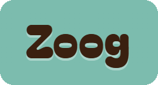
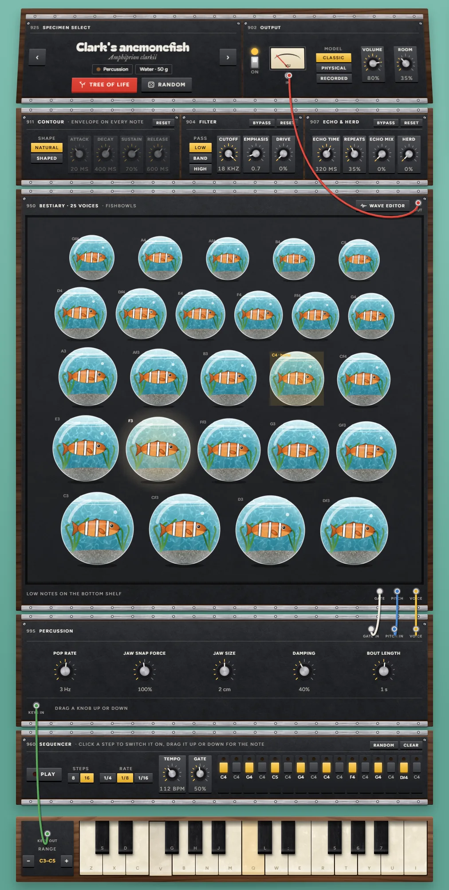
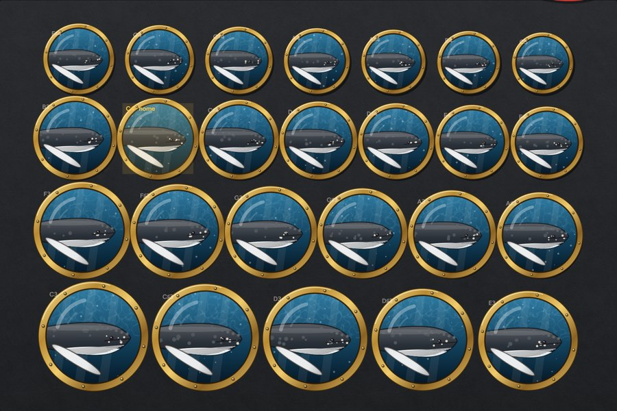
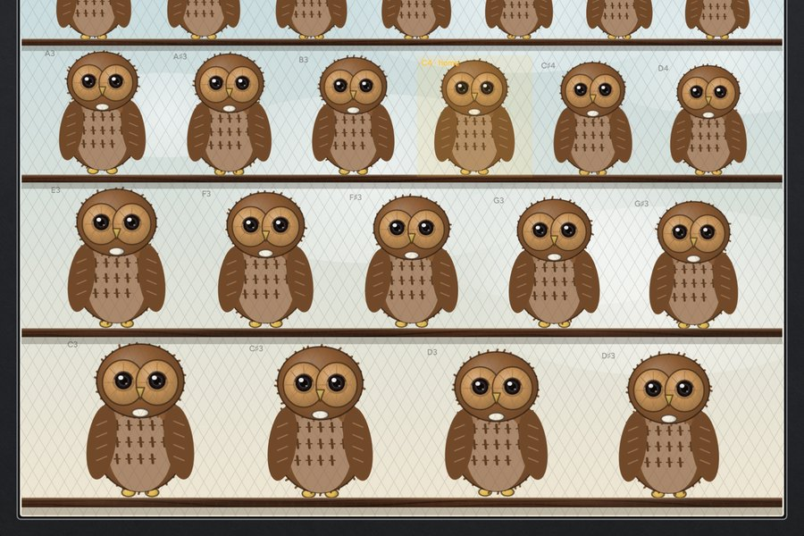
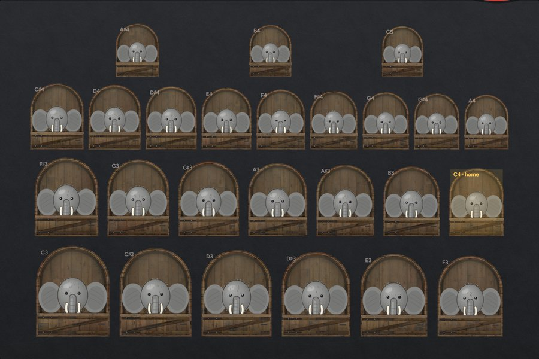
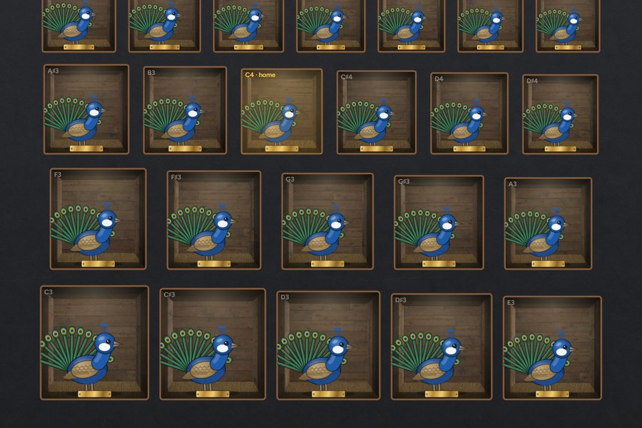
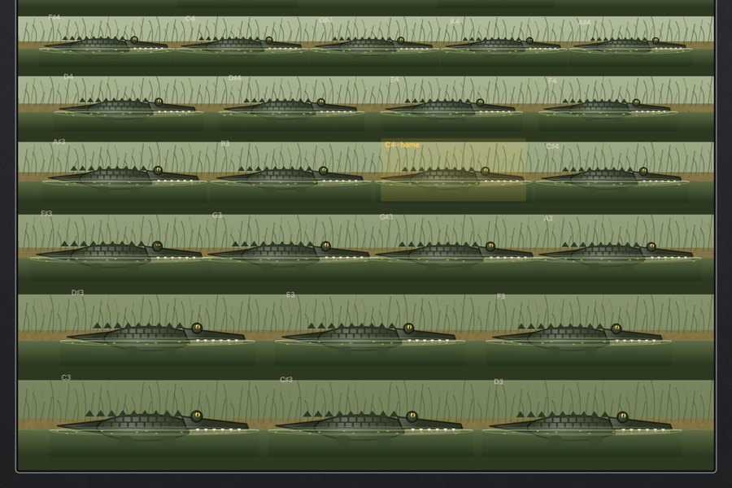
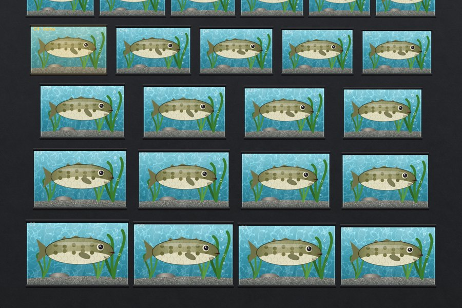

  

  <b>A modular synthesizer of 142 animal voices, in the browser.</b> 
  Pick a species from the tree of life, then play the whole cabinet from the keyboard.

  

  

---

Every key on the keyboard is an animal in the cabinet above it, pitched to that note. The cabinet is built
for whoever lives in it: portholes for whales, aquarium tanks and fishbowls for fish, perching wires for
small birds, stalls for elephants, wallows for crocodilians, matchbox drawers for crickets. The animals are
drawn and animated in code, and each one moves as it calls.

<table>
  <tr>
    <td width="33%"> <b>Humpback whale</b> · portholes</td>
    <td width="33%"> <b>Tawny owl</b> · perching wires</td>
    <td width="33%"> <b>African bush elephant</b> · stalls</td>
  </tr>
  <tr>
    <td> <b>Indian peafowl</b> · cubbyholes</td>
    <td> <b>American alligator</b> · wallows</td>
    <td> <b>Atlantic cod</b> · aquarium tanks</td>
  </tr>
</table>

## Three ways to make an animal sound

| Model | How it works |
| --- | --- |
| **Classic** | Models the sound-making *mechanism*: larynx, syrinx, trunk, swim bladder, stridulating wing file, tymbal and so on (18 in all), each with its own controls, from a cricket's file teeth to a cassowary's casque. |
| **Physical** | Simulates the *anatomy*. Birds get a syrinx oscillator feeding a waveguide trachea. Mammals, frogs and reptiles get a Kelly–Lochbaum vocal tract with jaw, tongue, lips and a nasal branch. |
| **Recorded** | Rebuilds 93 species from *measurements* of real field recordings (pitch contour, harmonics, spectral and noise envelopes), resynthesised live. Only the measurements ship, never the audio. |

## The modules

- **Specimen select & tree of life**: browse all 142 species on a zoomable Darwin-style tree, or roll a random one.
- **Contour**: a natural or shaped envelope on every note.
- **Filter**: low, band or high pass, with emphasis and drive.
- **Echo & herd**: echo, and a herd that thickens one animal into many.
- **Sequencer**: 8 or 16 steps, played by the animals.
- **Wave editor**: flip the cabinet round to trim the call itself.

Play it with the mouse or touch, from the computer keyboard (two rows, Z–M and Q–I), or with a MIDI
keyboard where the browser allows it.

## Under the hood

Plain JavaScript with no frameworks and no build step. The sound engine runs in an AudioWorklet, and
every animal, enclosure and texture is drawn on canvas. The Recorded model comes from an offline
analysis pipeline (pitch tracking, harmonic fitting, noise modelling) run on recordings from Wikimedia Commons
and the U.S. National Park Service sound gallery. Hosted on Cloudflare Pages.

## Credits

Each recorded species shows its source recording's author and licence inside the app; measurements
derived from CC BY-SA recordings carry the same licence. Panel, metal, plastic and enclosure textures are
baked from [ambientCG](https://ambientcg.com) packs (CC0). The walnut, knob caps and water caustics are
generated.

---

This repository is a showcase: the source code is private. © Matthew Lenkiewicz. Images and text
all rights reserved.
